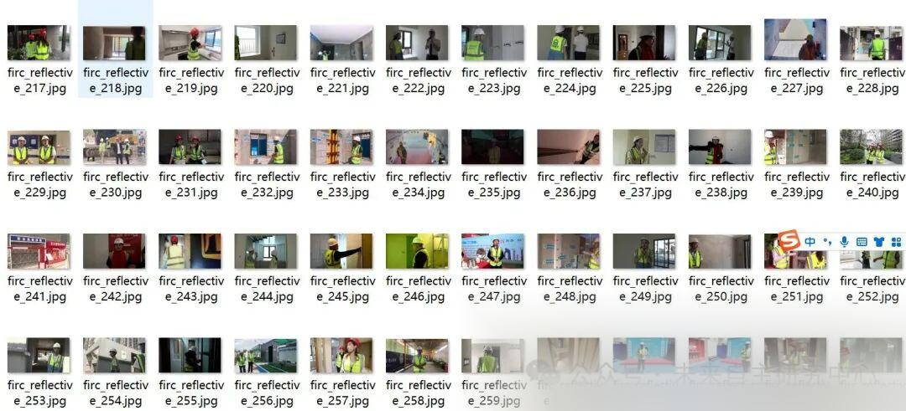
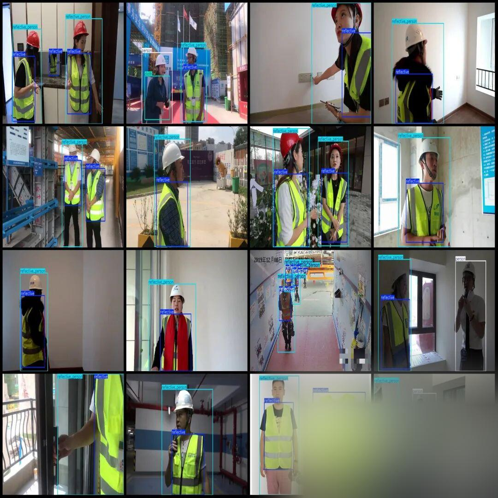

# High-quality reflective clothing dataset VOC+YOLO format with 5208 images in 4 categories

Dataset format: Pascal VOC format + YOLO format (txt file without split path, only containing jpg images and corresponding VOC format xml files and yolo format txt files)

Number of images (number of jpg files): 5208

Number of annotations (number of xml files): 5208

Number of annotations (number of txt files): 5208

Labeling category count: 4

Label category names (note that the order of categories in the YOLO format does not correspond to this, but is based on the labels folder's classes.txt): ["cloth", "person", "reflective", "reflective_person"]

Number of boxes labeled in each category:

Cloth frame count = 656

Person Frames = 774

Number of reflective frames = 7188

reflective_person frame count = 7213

Total frame count: 15831

Using labelImg:

Annotation rules: Draw a rectangle around the category.

Important Notice: No

Special : This dataset does not guarantee the accuracy or precision of the trained models or weight files. The dataset is provided with accurate and reasonable annotations only.

reflective_person refers to someone wearing reflective clothing.

reflective

Person refers to an individual who is not wearing reflective clothing.

Cloth is non-reflective clothing.

Image Preview:

Annotation example:

## Payment

Here is a pay link on Stripe ( https://buy.stripe.com/3cs8yP7sY87d0vu9AB ). Please contact me lonlonago@foxmail.com after funding $89, and I will send you a complete data files , thank you!

